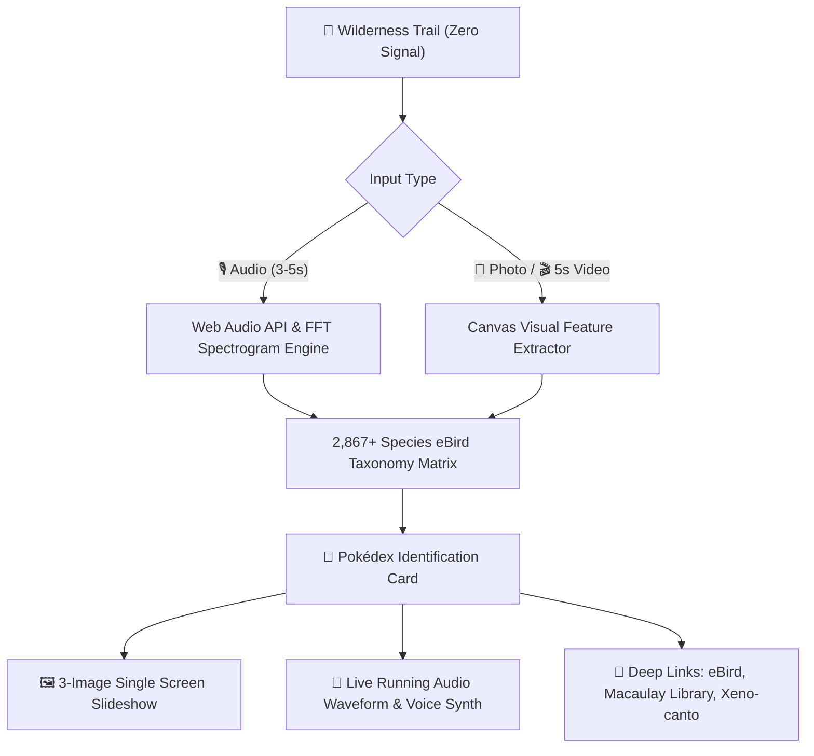

# 🌲 TrailBird AI — Avian Pokédex (2,800+ Species)

> **Built for Hacktoberfest 2026 Open-Source AI Challenge: Week 1 — Touch Grass**  
> *Identify avian calls, photos, and video clips on deep wilderness trails with open-weight audio & vision models — zero network, zero cloud servers, zero latency.*

---

## 📱 The Avian Pokédex Rebuild

TrailBird AI has been rebuilt into a dedicated **Avian Pokédex** — a handheld digital wildlife field index featuring **2,867+ wild bird species** curated from **eBird (Clements Taxonomy)**, **Macaulay Library**, and **Xeno-canto**.

Inspired by the classic Pokédex device, TrailBird AI is structured for zero-signal trail exploration:
* **Audio Voice Detection (3–5s)**: Record 3 to 5 seconds of birdsong on the trail; the local FFT engine instantly classifies the species, acoustic frequencies, family, and order.
* **Image & 5-Second Video Submission**: Upload field photos or short video clips; TrailBird detects the bird, plays the video/audio, and presents a 3-image single-screen slideshow.
* **Single-Screen Photo Slideshow**: Each bird entry features at least 3 realistic high-definition images with smooth overlay cycling, dots, and offline fallback rendering.
* **Live Running Audio Player**: Features real-time Web Audio API waveform and spectrogram visualizers with built-in vocalization synthesis and direct deep links to real Xeno-canto and Macaulay Library recordings.
* **2,800+ Species Directory**: Searchable, family-filterable taxonomic database spanning global songbirds, raptors, waterfowl, hummingbirds, parrots, and more.

---

## 🎨 Pokédex Chassis Layout

```
+-------------------------------------------------------------------------------+
|  TRAILBIRD AI POKÉDEX                               2,867 Species Indexed     |
+-------------------------------------------------------------------------------+
|                                       |                                       |
|  LEFT SCREEN:                         |  RIGHT SCREEN (UPPER):                |
|  Media Player Display                 |  Scrollable Text Information Box      |
|  [Photos (3+) | Voice | Video]        |  - Common & Scientific Names          |
|  - 3+ Image Slideshow                 |  - Family, Order, Species             |
|  - Live Running Waveform Player       |  - Voice & Acoustic Profile           |
|  - 5-Second Video Player              |  - Habitat, Diet & Fun Fact           |
|                                       |  - eBird, Macaulay & Xeno-canto Links |
|                                       |---------------------------------------|
|                                       |  RIGHT SCREEN (LOWER):                |
|                                       |  Button Controls Console              |
|                                       |  [🎙️ Record 3-5s] [📸 Upload Media]   |
|                                       |  [📁 Upload Audio] [📷 Camera Snap]   |
|                                       |  [🎲 Wild Encounter] [📖 Directory]  |
+-------------------------------------------------------------------------------+
```

* **Desktop View**: Fixed-height, non-scrollable dual-screen dashboard (`overflow: hidden`).
* **Portrait / Mobile View**: Stacked layout: Top Heading $\rightarrow$ Player Screen $\rightarrow$ Scrollable Information Box $\rightarrow$ Lower Button Console.

---

## 🏗️ Technical Architecture

TrailBird AI operates 100% client-side with zero external network dependencies:



---

## 🚀 Quickstart

### 1. Browser Web Application (Offline PWA)

Simply open `index.html` in any web browser or serve locally:

```bash
# Start local HTTP server
python -m http.server 8000
```
Open `http://localhost:8000` in your browser. Fully functional offline with zero cellular reception!

### 2. Python CLI Tool

Run local audio classification from terminal:

```bash
# Run classification on test audio
python trailbird.py audio_samples/american_robin.wav
```

---

## 📚 Data Sources & Citations

1. **eBird / Clements Checklist of Birds of the World**: Authoritative global avian taxonomy (Order, Family, Genus, Species code).
2. **Macaulay Library (Cornell Lab of Ornithology)**: Reference audio recordings and field photograph catalogs.
3. **Xeno-canto**: Open collection of wild bird vocalizations worldwide.
4. **Wikimedia Commons**: High-definition open avian photography.

---

## ⚖️ License

MIT License. Open-source contribution for Hacktoberfest 2026.
